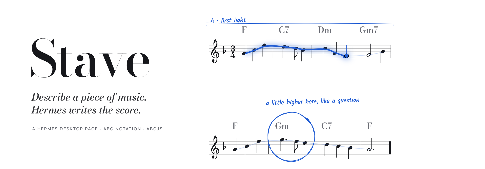
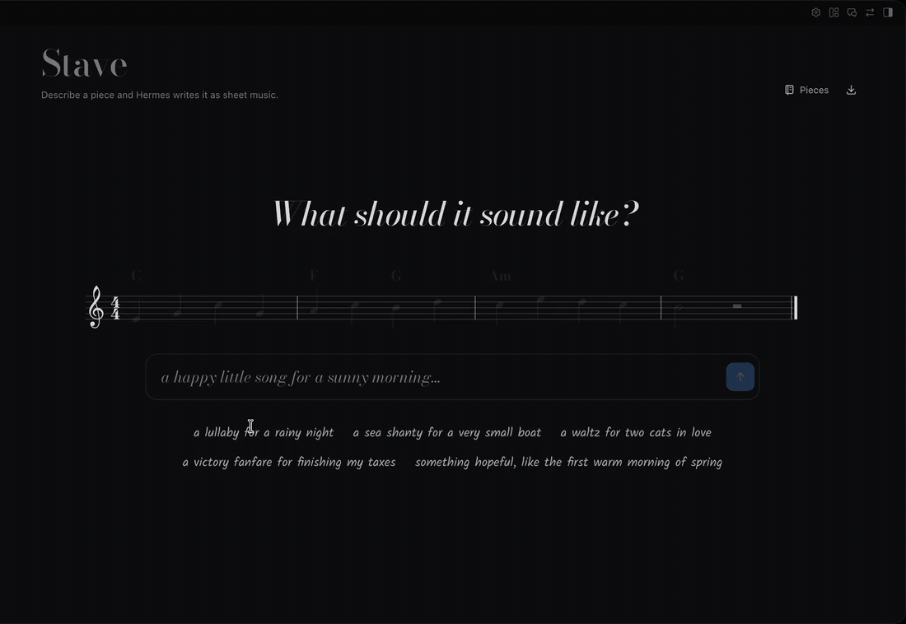
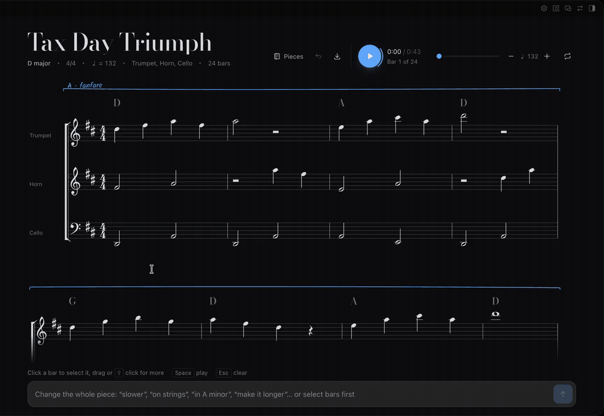
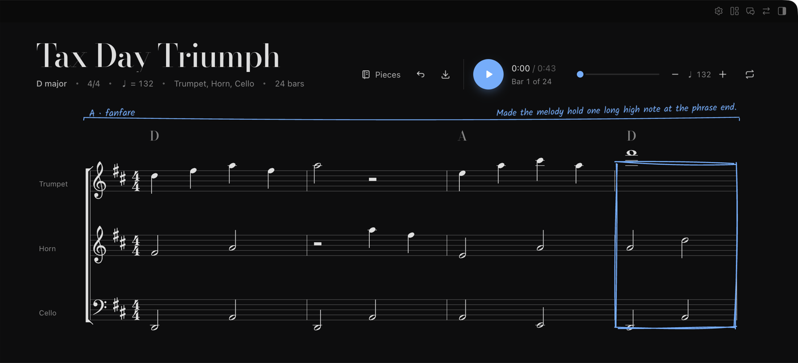

<p align="center">
  <picture>
    <source media="(prefers-color-scheme: dark)" srcset="docs/images/banner-dark.png">
    
  </picture>
</p>

<p align="center">
  <b>A Hermes Desktop page that writes music you can read, hear, and change.</b><br>
  <sub>Type a sentence. Hermes plans the form, writes every note, checks its own bars, and engraves the score.<br>Press play and follow the light along the melody. Circle a bar and ask for something else.</sub>
</p>

<p align="center">
  <a href="#rehearsal">Install</a> ·
  <a href="#the-suite">How it works</a> ·
  <a href="#liner-notes">What it does on your machine</a> ·
  <a href="LICENSE">MIT</a>
</p>

<p align="center">
  
</p>

## Prelude

Most music generators hand you a sound file. Stave hands you the score.

Hermes writes the piece as notation, so every note is on the page. You can see why the ending feels finished, hear the cello take the tune, and take the whole thing to GarageBand, MuseScore or a real piano as MIDI. You don't need to read music. The notes light up as they sound, and a line runs along the melody so your eye knows where to look.

## The suite

### I. *Allegro* · you ask

Describe what you want in plain words: "a lullaby for a rainy night", "a sea shanty for a very small boat", "something hopeful, like the first warm morning of spring". Name an instrument, a tempo or a length if you care. Hermes fills in the rest.

### II. *Andante* · Hermes plans the form

Before any notes, Hermes decides the shape: key, meter, tempo, two or three instruments, and two to four sections with a chord for every bar. The plan appears on the staff in pencil while the notes are still being written: *A · rainfall, B · deep clouds, A · rainfall*.

### III. *Moderato* · it writes, checks, and corrects itself

Each section is written in [ABC notation](https://abcnotation.com/) and checked before you see it:

| Check | What fails it |
|---|---|
| **Bar length** | any part whose notes do not add up to the meter (6/8 needs six eighths, triplets included) |
| **Range** | a note a flute or a cello could not play (treble parts G3 to F6, bass parts E1 to G4) |
| **Syntax** | stray bar lines, unclosed chord symbols, anything the engraver cannot parse |

Bars that fail go back to Hermes with the reason, once. The repaired ones are circled in the margin, *checked and fixed*, so you can see where it corrected itself.

### IV. *Cantabile* · it plays

<p align="center">
  
</p>

Press play or Space. Each instrument plays with its own sampled voice: music box, harp, cello, flute, strings, celesta and a dozen more. The melody lights in full blue, the accompaniment in a softer tint, and the page turns itself when the music moves to the next system. Slow it down, speed it up, or loop just the bars you selected.

### V. *Rubato* · you change it

<p align="center">
  
</p>

Click a bar, drag across several, or Shift-click, then say what you want: *sadder*, *end on a long note*, *simpler bass*, *more like a question*. Hermes rewrites only those bars, boxes them in pencil, and writes what it changed in the margin. With nothing selected, a request applies to the whole piece: *slower*, *on strings*, *in A minor*, *make it longer*.

### *Da capo* · nothing is lost

Every change keeps a snapshot. Undo with the arrow or ⌘Z / Ctrl+Z and you are back where you were. Your pieces stay in the Pieces menu.

## The score

| | |
|---|---|
| **Instruments** | piano, music box, celesta, vibraphone, marimba, guitar, harp, violin, viola, cello, double bass, strings, choir, trumpet, horn, clarinet, oboe, flute, pan flute |
| **Meters** | 4/4, 3/4, 6/8, 2/4 |
| **Keys** | C, G, D, A, F, B♭, E♭ major; A, E, B, F♯, D, G, C minor |
| **Length** | 16 to 32 bars in 2 to 4 sections, longer on request |
| **Export** | MIDI · WAV · the engraved score as SVG, ready to print · ABC text |

## Rehearsal

Stave is a Hermes Desktop plugin.

```bash
hermes plugins install https://github.com/Adolanium/hermes-stave
```

Enable **Stave** in Capabilities → Plugins. It appears in the sidebar and as *Open Stave* in the command palette (⌘K).

**Which model writes the music.** By default Stave uses your chat model, which writes the most musical pieces. The export menu can switch it to Hermes's faster helper model, which costs less. A 24-bar piece takes about 40 seconds on a fast model.

### Building from source

```bash
cd desktop-src
npm ci
npm run build    # writes desktop/plugin.js
npm test
```

To work on it live, link the `desktop/` folder into Hermes Desktop. Every build reloads the page:

```bash
ln -s "$PWD/desktop" ~/.hermes/desktop-plugins/stave
```

## Liner notes

What Stave does on your machine, in full:

- **Model calls.** Every step is one stateless `llm.oneshot` request through Hermes: one to plan, one per section, one per repair, one per change. Nothing runs in the gateway and no agent tools are added.
- **One hidden session.** With "your chat model" selected, Stave creates one hidden Hermes session titled *Stave* so a one-shot request can borrow that session's model. Hermes does not let plugins delete sessions; you can remove it from the session list.
- **Network.** Playback downloads instrument samples from `paulrosen.github.io/midi-js-soundfonts` the first time each instrument plays. Nothing else leaves your machine except the model calls you already route through Hermes.
- **Storage.** Pieces, their undo history and your model choice live in the plugin's own Desktop storage. Stave writes no files unless you export one.
- **Sound.** Audio plays only when you press play. Stave never uses the microphone.

## Coda

Stave stands on the work of others:

- [**abcjs**](https://github.com/paulrosen/abcjs) by Paul Rosen (MIT) engraves the notation and plays it.
- [**Rough Notation**](https://github.com/rough-stuff/rough-notation) by Preet Shihn (MIT) draws Hermes's pencil marks.
- [**Bodoni Moda**](https://github.com/indestructible-type/Bodoni) and [**Kalam**](https://github.com/itfoundry/kalam) (SIL Open Font License 1.1) set the titles and the handwriting.
- The instrument samples are the **FluidR3 GM** soundfont, converted by [midi-js-soundfonts](https://github.com/gleitz/midi-js-soundfonts).

Released under the [MIT License](LICENSE).

<p align="center"><sub><i>Fine.</i></sub></p>
